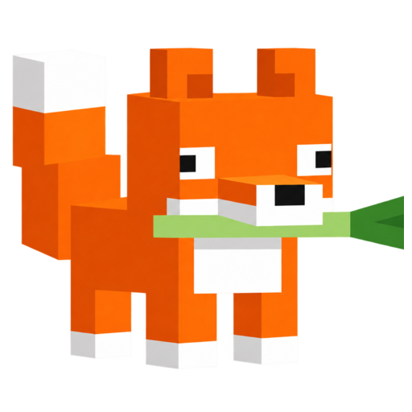

    

# NegiCraft Launcher

[提交问题](https://github.com/negichan/NegiCraft-Launcher/issues/new)

NegiCraft Launcher（简称 NCL）是一个美观、优雅、又有点笨蛋的 Minecraft 启动器。

## 功能

- 🦊我只是一个Minecraft启动器

## 支持平台

| 操作系统 | 支持情况 |
|---|---|
| Windows 10 / 11 x64 | ✅ |
| macOS / Linux | ⚠️ |

需要 [.NET 10 Desktop Runtime](https://get.dot.net/10)。Windows 7 和 8 用不了，.NET 10 本身就不支持它们；macOS 与 Linux 只是代码里有分支，从没在 Windows 之外跑通过一次，能编译不代表能启动。

## 许可证

- 本项目源码使用 [MIT 许可证](LICENSE)。
- `libs/` 下为内置的第三方代码，各自保留原始许可与声明，见对应目录内的 `LICENSE` 与 `VENDOR.md`。

## 第三方资源

界面里的图标不全是本项目自己画的，逐项声明如下（完整版见
`src/NegiCraftLauncher.Raster/Assets/ICONS-NOTICE.md`）：

- **等距方块图标**（`block_*.png`，18 张，草方块 / 石头 / TNT / 铁砧等）来自
  **[ccVaults](https://ccvaults.com/)**（ccLeaf 旗下的 Minecraft 素材库）。
  原图 1024×1024，随程序打包（不压缩分辨率，显示时再缩）。
  这些图**并非自由许可** —— ccLeaf 保留所有权利，其服务条款也禁止抓取与再分发；
  此处按花子 2026-10-20 的决定使用，并在此注明来源。如需移除，删掉这些文件即可，
  程序会自动退到自绘的兜底图标。
- **加载器标志**：Fabric 的图标来自 FabricMC（MIT），NeoForge 的来自 NeoForged（Unlicense），
  Quilt 的来自 QuiltMC 的 `art` 仓库（该仓库未附许可证，按「指明来源」的合理使用处理）。
  商标权仍归各自所有。
- 方块造型与贴图本身是 Minecraft 的美术资源，著作权归 Mojang / Microsoft。

